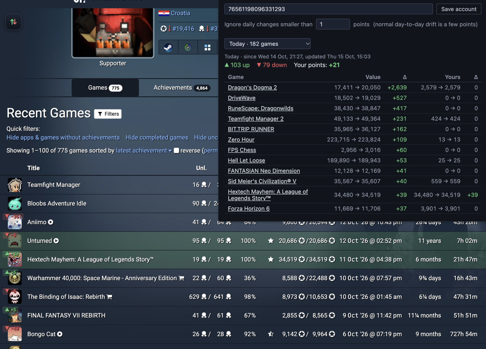

# SteamHunters D2D Point Tracker

A Chrome and Firefox extension (also available as a userscript) that shows which games on your [Steam Hunters](https://steamhunters.com) profile went up or down in points from day to day, so you can see what each recalculation did to your score without comparing pages by hand.

- Checks your library every 6 hours and keeps a report for each day: every game whose point value moved, by how much, and what it did to your own points.
- Built for big libraries: search, ▲ Up / ▼ Down filters, **Mine only** (games where your own points changed), sortable columns, and a list that stays quick with tens of thousands of games.
- Tags changed games with ▲/▼ right in the game list on your Steam Hunters profile.
- Ignores small day-to-day drift (under 5 points by default, adjustable).
- No login or API key. It reads Steam Hunters' public data for your profile.

## Screenshots



## Install

### Chrome (and other Chromium browsers: Edge, Brave, Opera)

1. Download `steamhunters-d2d-point-tracker-v<version>.zip` from [Releases](../../releases/latest) and unzip it.
2. Open `chrome://extensions` and turn on **Developer mode** (top right).
3. Click **Load unpacked** and pick the unzipped `steamhunters-d2d-point-tracker` folder.
4. Click the extension icon and enter your Steam profile URL, vanity name or SteamID64. You can also open your Steam Hunters profile, click the tracker icon (top left) and choose **This is my account**.

### Firefox

1. Download the `-firefox` zip from [Releases](../../releases/latest), or build it yourself with `node build.mjs`, which writes it to `dist/`.
2. Open `about:debugging#/runtime/this-firefox` and click **Load Temporary Add-on...**.
3. Pick the `-firefox` zip (no need to unzip it).
4. Open `about:addons`, click **SteamHunters D2D Point Tracker**, go to the **Permissions** tab, and turn on access for `steamhunters.com` and `steamcommunity.com` if they're off.
5. Set your account as in step 4 for Chrome.

Temporary add-ons are removed when Firefox restarts, so you'll need to load it again after a restart. For a permanent install, the zip has to be signed through [addons.mozilla.org](https://addons.mozilla.org/developers/).

### Userscript (Tampermonkey / Violentmonkey)

1. Install [Tampermonkey](https://www.tampermonkey.net/) or [Violentmonkey](https://violentmonkey.github.io/) in your browser.
2. Open [steamhunters-d2d-point-tracker.user.js](https://github.com/rushhee/steamhunters-d2d-point-tracker/releases/latest/download/steamhunters-d2d-point-tracker.user.js) and click **Install** when the userscript manager asks.
3. Open your Steam Hunters profile, click the tracker icon (top left) and choose **This is my account**.

Userscripts only run while a page is open, so the 6-hourly check happens the next time you visit any Steam Hunters page once it's due. The report lives in the panel on your profile page. The userscript manager's menu has **Check now**, **Ignore changes smaller than…** and **Open my profile**, in place of the extension popup. Updates are picked up automatically from the latest release. Greasemonkey isn't supported.

## Clearing past days

The extension keeps the last 50 days of reports and drops older ones by itself. To clear them sooner, remove the stored `reports`. Your account, settings and today's baseline stay, so tracking carries on and today's report comes back at the next check.

**Chrome**

1. Open `chrome://extensions` with **Developer mode** on.
2. On the tracker's card, click **service worker** next to **Inspect views**.
3. In the **Console** tab, run:

   ```js
   chrome.storage.local.remove("reports")
   ```

To wipe everything instead (account, settings, baseline and history), remove the extension and load it again. You can also close Chrome and delete the extension's storage folder. The ID is shown on its card in `chrome://extensions`, and `Default` is your Chrome profile folder.

- Windows: `%LOCALAPPDATA%\Google\Chrome\User Data\Default\Local Extension Settings\<extension ID>`
- macOS: `~/Library/Application Support/Google/Chrome/Default/Local Extension Settings/<extension ID>`

**Firefox**

Open `about:debugging#/runtime/this-firefox`, click **Inspect** on the tracker, and run the same command in the **Console** tab.

**Userscript**

- Tampermonkey: open the dashboard, click the script and open its **Storage** tab. You may need to set **Config mode** to **Advanced** in Tampermonkey's settings first. Delete the `"reports"` entry and save.
- Violentmonkey: open the dashboard, edit the script, open the **Values** tab and delete `reports`.

## Building

`node build.mjs` (Node 18+, no dependencies) writes to `dist/`:

- `steamhunters-d2d-point-tracker-v<version>.zip`: Chrome, a folder to load unpacked.
- `steamhunters-d2d-point-tracker-v<version>-firefox.zip`: Firefox, with a generated manifest (background script instead of a service worker, gecko ID).
- `steamhunters-d2d-point-tracker.user.js`: the userscript. It wraps the extension sources unchanged around a small shim (`userscript/shim.js`) that stands in for the `chrome.*` APIs.

The version comes from `extension/manifest.json`, so bump it there for userscript managers to pick up an update.

## Command-line version

`shtrack.py` does the same comparison from a terminal (Python 3, no dependencies) and can schedule itself daily with launchd on macOS:

```
python3 shtrack.py setup <steam profile URL | vanity name | SteamID64>
python3 shtrack.py check
python3 shtrack.py last
python3 shtrack.py schedule 09:00
```

## Notes

Data comes from Steam Hunters' `steam-users/<id>/licenses` API, which isn't documented and may change. Your Steam profile and game details need to be public, and your profile synced on Steam Hunters. Switching accounts clears the history for the previous one.
